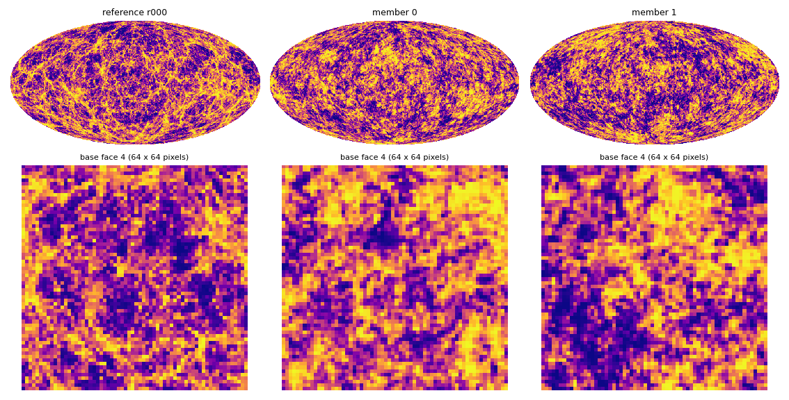
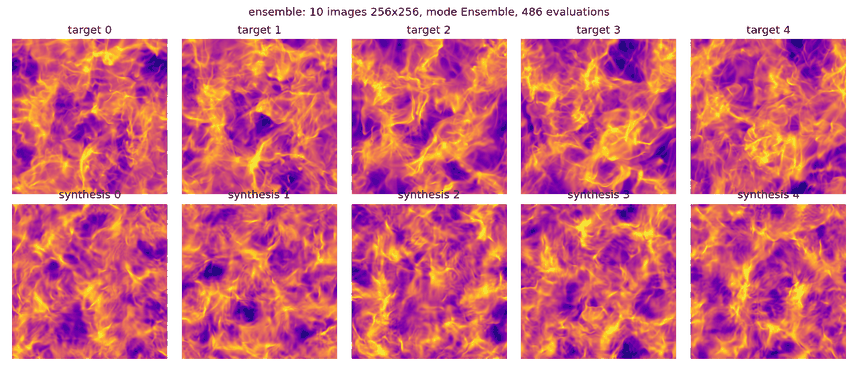

# STL-Dev-MPI

[](docs/index.md)
[](Cargo.toml)
[](Cargo.toml)

**STL-Dev-MPI** computes scattering-covariance statistics of maps on the sphere
([HEALPix](https://healpix.sourceforge.io/)) and on periodic 2D grids, and synthesises new maps
whose statistics match those of a target, at resolutions and ensemble sizes that do not fit in
memory with automatic differentiation: nside 2048 and beyond, on many CPU nodes or GPUs.

It is the Rust + MPI + CUDA port of the patch-local engine of
[STL-Dev](https://github.com/STL-Proj/STL-Dev) (branch `HealpixUpdate`). The statistics (`mean`,
`var`, S1, S2, S3, S4 with `L = 4` orientations) and their gradient are computed **block by block
over the multiresolution pyramid**, with hand-written vector–Jacobian products instead of an
autograd graph, and the sky is split between MPI ranks: the memory of every rank is bounded by
its share of the sky, not by the full sky. Results match STL-Dev to 1e-10, and 1, 2, 4, ... ranks
give the same statistics to 1e-15.

## Features

| | |
|---|---|
| **Statistics** | the full ScatCov plan on HEALPix (NESTED) and periodic 2D grids, 1 or several channels, both S3/S4 definitions; geometry computed on the fly per block, never stored for the full sky |
| **Synthesis** | L-BFGS with strong Wolfe line search (transcribed from `torch.optim.LBFGS`), the map as variable, white-noise or coarse-to-fine starts, ergodic (reduced χ²) weights |
| **Ensembles** | `B` members whose mean (and scatter) of statistics match a target; P. Campeti's method (ScatCov of `g` and `kappa`, C_ℓ, PDF, Minkowski functionals) in `stl-ensemble`; extra terms for level power, histograms, kurtosis, Minkowski functionals |
| **Bounded memory** | blocks of constant size with halos; maps, stored moduli and L-BFGS history sliced by rank; blocks sized from the free device memory on GPUs |
| **MPI** | contiguous NESTED ranges per rank, point-to-point halos, additive ghost cells, reductions in rank order (deterministic); groups of ranks per ensemble member |
| **CUDA** | one GPU per rank, `f64`, kernels compiled at run time by NVRTC (no toolkit to build), deterministic; DIA convolution, geometry cache on the device or in pinned host memory, objective terms on the device |
| **Differentiable Python API** | `stl_port.native`: statistics of full-sky maps (`NativeEngine`), averaged over `K` masks in one sweep, of disc patches (`PatchEngine`), auto and cross `S(a, b)`, and pseudo-`C_ℓ` of spin 0 and spin `s` fields (`SpectrumEngine`, anafast conventions), each with its exact VJP on CPU or GPU, for torch losses ([guide](docs/user-guide/differentiable.md), [example 06](examples/06_differentiable_python)) |
| **Validation** | every operation and every statistic tested against fixtures dumped from STL-Dev; synthesis trajectories reproduce STL-Dev's losses at the printed digits |

## Installation

```bash
git clone https://github.com/jmdelouis/STL-Dev-MPI.git      # private: ask jmdelouis for access
cd STL-Dev-MPI
cargo build --release -p stl-cli                            # CPU, ranks as threads (--ranks N)
cargo build --release -p stl-cli --features mpi             # + MPI (mpirun)
cargo build --release -p stl-cli --features "gpu mpi"       # + one CUDA device per rank (--gpu)
cargo test --release                                        # fixture tests against STL-Dev
```

### Requirements

- Rust stable (edition 2021), a C compiler;
- feature `mpi`: an MPI library (OpenMPI 4/5, Intel MPI, MPICH) and `libclang` at build time;
- feature `gpu`: an NVIDIA driver and NVRTC at run time (no CUDA toolkit needed to build;
  `CUDARC_CUDA_VERSION=12040` sets the driver API version), cuFFT for the harmonic terms of
  `stl-ensemble`;
- optional, for target preparation and figures: Python 3.10+ with `numpy`, `scipy`,
  `matplotlib`, `healpix-geo`.

Details, computing-centre installs without root rights and batch scripts:
[installation](docs/installation.md) and [USAGE](docs/USAGE.md).

## Quick start

```bash
# synthesis of a HEALPix map from a target (NESTED .npy or FITS), 8 thread ranks
stl-synth --target fixtures/synthesis/synthesis_kap_nside64_nested_niter20/target_map.npy \
    --weights ergodic --niter 100 --ranks 8 --out run
# the same on a GPU; on 4 GPUs under MPI
stl-synth --target map.npy --weights ergodic --niter 100 --gpu --out run
mpirun -n 4 stl-synth --target map.npy --weights ergodic --niter 100 --gpu --out run
# statistics of maps (JSON: plan + values)
stl-stats --out stats.json --norm map.npy -- map.npy run_synthesis_nested.npy
# ensemble with P. Campeti's method
stl-ensemble calibrate --references r00?.npy --nside 128 --out cal.json
stl-ensemble run --calibration cal.json --niter 500 --gpu --out ens
# 2D: STL-Dev's example, 10 images of 256 x 256
stl-synth2d --target Turb_6.npy --ntarget 10 --nbatch 10 --mode stldev --niter 100 --gpu --out run2d
```

Each run writes a JSON report (`loss_history`, `seconds_per_evaluation`, `timers_seconds`,
`memory_peak_bytes_per_rank`, residuals per family) and the maps (`.npy`, HEALPix FITS).

| Ensemble of weak-lensing maps at nside 64 ([example 02](examples/02_healpix_ensemble)) | STL-Dev's 2D example ([example 04](examples/04_planar_synthesis)) |
|---|---|
|  |  |

## Examples

| | Example | Tool |
|---|---|---|
| 01 | [HEALPix synthesis of one map, CPU and GPU, and the recipe for skewed fields](examples/01_healpix_synthesis) | `stl-synth` |
| 02 | [Ensemble synthesis, 10 members, P. Campeti's method](examples/02_healpix_ensemble) | `stl-ensemble` |
| 03 | [Statistics of maps](examples/03_statistics) | `stl-stats` |
| 04 | [2D synthesis, 10 images of 256², CPU and GPU](examples/04_planar_synthesis) | `stl-synth2d` |
| 05 | [Multi-rank runs under MPI](examples/05_mpi) | `mpirun`, `stl-mpi-check` |
| 06 | [Differentiable losses in Python: masks, patches, cross statistics, C_ℓ](examples/06_differentiable_python) | `stl_port.native` + torch |

## Performance

Same synthesis as STL-Dev, nside 128 × 4 members, `L = 4`, full plan (3970 coefficients),
100 L-BFGS iterations, one A100-SXM4-80GB ([report](docs/bench_n128.md)):

| Code | Configuration | s / evaluation | GPU peak | Host RSS |
|---|---|---|---|---|
| STL-Dev (autograd) | minimum time | 1.229 | 19.8 GB | 6.4 GB |
| STL-Dev (autograd) | minimum memory | 4.723 | 12.3 GB | 6.4 GB |
| STL-Dev-MPI | minimum time (`--gpu-fields keep`) | **0.106** | 2.2 GB | 0.74 GB |
| STL-Dev-MPI | minimum memory (`recompute`, 1024-cell blocks) | 0.885 | **0.58 GB** | 0.72 GB |

The gradients agree to 2.7e-13. Planar images, STL-Dev's loss
([report](docs/planar_2d.md)):

| Images | STL-Dev CPU (12 threads) | STL-Dev-MPI CPU | STL-Dev T4 | STL-Dev-MPI T4 | STL-Dev A100 | STL-Dev-MPI A100 |
|---|---|---|---|---|---|---|
| 10 × 256² | 5.0 s, 4.5 GB | **0.46 s, 0.30 GB** | 0.64 s, 2.8 GB | **0.18 s, 0.31 GB** | 0.120 s, 2.8 GB | **0.032 s, 0.59 GB** |
| 1 × 2048² | 79–294 s, 41.9 GB | **5.2 s, 0.82 GB** | out of memory | **1.18 s, 0.72 GB** | 0.481 s, 40.7 GB | **0.154 s, 0.96 GB** |
| 1 × 4096² | (~150 GB) | **29 s, 2.9 GB** | – | **4.9 s, 1.9 GB** | out of memory | **0.60 s, 1.93 GB** |

At scale: nside 1024 (`L = 2`) in 10.2 s per evaluation on 192 CPU cores (75 % parallel
efficiency from 24 cores), 5.1 s on three Tesla T4; ten members at nside 1024 with
P. Campeti's objective on one A100 ([production](docs/campeti_production_1024.md)).

## Documentation

The documentation site (Sphinx + MyST, built with `docs/build.sh`) starts at
[docs/index.md](docs/index.md):

- [Installation](docs/installation.md) · [Tutorials](docs/tutorials/index.md) ·
  [Terminology](docs/terminology.md)
- User guide: [concepts](docs/user-guide/concepts.md) (pyramid, blocks and halos, stored moduli,
  explicit VJP), [command-line tools](docs/user-guide/cli.md), [GPU](docs/user-guide/gpu.md),
  [MPI](docs/user-guide/mpi.md), [computing centres](docs/USAGE.md)
- [API reference](docs/api.md) (and `cargo doc --open`)
- [Reports and measurements](docs/reports.md), [validation against STL-Dev](docs/validation.md)

## Repository layout

| Path | Content |
|---|---|
| `crates/stl-core` | HEALPix geometry, convolution and adjoint, decimation and pieces, block-wise sweeps (`LocalEngine`), plans, L-BFGS, planar engine; no MPI, `f64` |
| `crates/stl-mpi` | decomposition, halo exchange, ghost accumulation (`Comm`: threads or MPI), distributed objective, npy / FITS I/O, `stl-mpi-check` |
| `crates/stl-gpu` | the sweeps on CUDA devices, one per rank (feature `gpu`) |
| `crates/stl-cli` | `stl-synth`, `stl-stats`, `stl-ensemble`, `stl-synth2d`, `stl-minkowski` |
| `crates/stl-bridge`, `python/` | C ABI and P. Campeti's Python ensemble driver |
| `examples/` | worked examples with scripts and figures |
| `docs/` | documentation site and reports |
| `tools/` | fixture dumps from STL-Dev, target preparation, figures, cluster environments and batch scripts (`hpc/`, `datarmor/`, `irene/`, `garoupe/`) |
| `fixtures/` | STL-Dev outputs the tests compare with |
| `benchmarks/` | reports of the cluster runs |
| `text/` | the paper |

## Development

```bash
cargo test --release                       # all fixture tests (threads backend)
tools/mpi_check.sh 2 4                     # under mpirun, 1, 2 and 4 ranks
CUDARC_CUDA_VERSION=12040 cargo test --release -p stl-gpu
pip install -r docs/requirements.txt && docs/build.sh     # documentation site + rustdoc
```

The model, architecture and validation rules are in [CLAUDE.md](CLAUDE.md); vocabulary and
numerics follow STL-Dev (block, halo, piece, sweep, native level, stored moduli, plan).

## License

MIT (declared in `Cargo.toml`).
