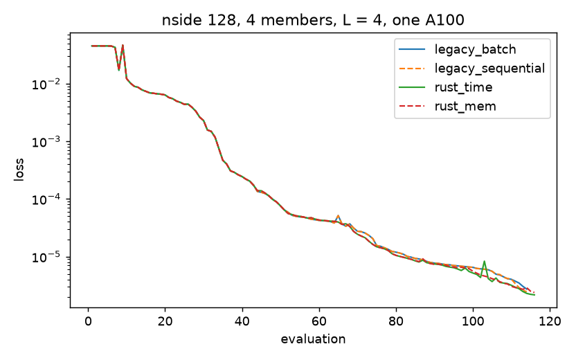

# nside 128 x 4 members on one A100: STL-Dev legacy against STL-Dev-MPI

A small, clean comparison of the same synthesis with two codes, in their
minimum-memory and minimum-time configurations, on one A100 of the hpc
cluster (job 2747854, 2026-11-02).

## Setup

Common to every run:

- target: Takahashi convergence map r000, z_s = 1, nside 128
  (`takahashi_r000_zs1_nside128_nested.npy`), standardised (population mean and std);
- statistics: the full ScatCov plan, `mean`, `var`, S1-S4, J = 6, L = 4, kernel 5,
  gauge `cosmo`, `vanilla` normalisation, standard S3/S4 definitions: 3970 coefficients;
- loss: `sum_i |(1/4) sum_m S_i(x_m) - S_i(target)|^2` over a 4-member ensemble
  (`stl-synth --weights none --ensemble 4`), no weights;
- optimiser: L-BFGS of `torch.optim.LBFGS` (strong Wolfe, `lr = 1`, history 10,
  `tolerance_grad = 1e-12`, `tolerance_change = 1e-15`), 100 iterations, at most 125
  evaluations; the Rust one is a transcription of it;
- initial maps: white noise, member m from `numpy.random.default_rng(1000 + m)`, in
  standardised units (`tools/bench_n128/make_inits.py`), read by both codes
  (`stl-synth --init init_m{m}.npy --init-units standardized --init-noise 0`);
- hardware: one A100-SXM4-80GB (compute-114-15, driver 595.71.05), 6 CPU cores, the runs
  one after the other in the same job (`tools/hpc/bench_n128.slurm`).

Codes:

- **STL-Dev legacy**: the full-sky path of STL-Dev, `ST_Operator.apply` differentiated
  by autograd (the reference against which `PyramidScattering.py` was tested), STL-Dev
  `HealpixUpdate` 90eb1a9, healpix-analyse 6f56e8e, torch 2.11.0+cu128, float64. The
  driver is `tools/bench_n128/legacy_synth.py`:
  - *minimum time* (`--mode batch`): the 4 maps as one batch, one autograd graph;
  - *minimum memory* (`--mode sequential`): one member at a time, a forward pass of every
    member without graph for the mean statistics, then each member again with its graph,
    back-propagated with the cotangent `2 (mean - target) / 4`. The legacy path has no
    patches, so this is its most frugal form; it costs one extra forward per member.
- **STL-Dev-MPI**: `stl-synth` from `main` 9c52ff4, one MPI rank:
  - *minimum time*: `--gpu --gpu-fields keep --gpu-terms device --gpu-cache full`
    (DIA convolution, the default);
  - *minimum memory*: `--gpu --gpu-fields recompute --gpu-cache none
    --gpu-block-rows 1024 --block-pixels 1024` (blocks of 1024 cells, wavelet fields and
    convolution geometry rebuilt by every block).

## Results

| Code | Configuration | s / evaluation | Evaluations | Optimisation s | Setup s | GPU peak GB (nvidia-smi) | GPU peak GB (code) | Host RSS GB | GPU busy % | Final loss |
|---|---|---|---|---|---|---|---|---|---|---|
| STL-Dev legacy | minimum time (batch) | 1.229 | 114 | 140.1 | 20.7 | 19.81 | 10.12 | 6.38 | 41 | 2.73e-6 |
| STL-Dev legacy | minimum memory (sequential) | 4.723 | 114 | 538.4 | 20.2 | 12.26 | 3.99 | 6.35 | 28 | 2.46e-6 |
| STL-Dev-MPI | minimum time (keep, device terms) | **0.106** | 116 | 12.3 | 9.4 | 2.23 | 2.02 | 0.74 | 58 | 2.17e-6 |
| STL-Dev-MPI | minimum memory (recompute, 1024-cell blocks) | 0.885 | 116 | 102.7 | 2.8 | **0.58** | 0.58 | 0.72 | 75 | 2.38e-6 |
| STL-Dev-MPI | CPU only, 6 MPI ranks, 1024-cell blocks | 8.785 | 116 | 1019.0 | 2.9 | 0 | 0 | 2.9 (0.48-0.49 per rank) | - | 3.70e-6 |

Columns:

- *s / evaluation*: optimisation time over the number of loss + gradient evaluations
  (setup excluded); *setup*: target statistics and geometry (legacy: healpix-analyse
  geometry built from scratch, see the note below; Rust: topology, decimation rows,
  target statistics);
- *GPU peak (nvidia-smi)*: maximum of `memory.used` for the whole device, sampled every
  200 ms (CUDA context and the torch caching allocator included); *GPU peak (code)*:
  legacy `torch.cuda.max_memory_allocated` (tensors only; reserved 19.27 and 11.71 GB),
  Rust `gpu.memory_peak_bytes_per_rank` (whole device, context included);
- *host RSS*: peak resident memory of the process (`getrusage`, `VmHWM`);
- *GPU busy*: mean `utilization.gpu` of nvidia-smi (fraction of time a kernel is
  running) over the optimisation.

Ratios, legacy over STL-Dev-MPI:

| | time per evaluation | GPU peak (nvidia-smi) | GPU peak (code) | host RSS |
|---|---|---|---|---|
| minimum time | 11.6 x | 8.9 x | 5.0 x | 8.6 x |
| minimum memory | 5.3 x | 21 x | 6.9 x | 8.8 x |
| legacy minimum time vs STL-Dev-MPI minimum memory | 1.4 x | 34 x | 17 x | 8.9 x |

So STL-Dev-MPI in its *memory-minimal* form is still faster than STL-Dev in its
*time-minimal* form, with 34 times less device memory.

The CPU fallback (no GPU at all; job 2749290, 6 cores of the cpu-partition node
compute-116-15, `mpirun -np 6 --oversubscribe`) takes 8.79 s per evaluation (forward
373 s, reverse 644 s, L-BFGS 1.7 s over the run), 1.9 times the legacy minimum-memory
run on the A100 and 83 times STL-Dev-MPI's minimum-time run. Its memory floor, the data
the algorithm holds (`memory_floor_bytes`), is about 37 MB in all: 25 MB of L-BFGS
history, 8 MB of stored moduli and their cotangents, 4 MB of maps and gradients; the
measured RSS, 0.48-0.49 GB per rank, is mostly the process itself (binary, MPI
runtime, per-rank buffers), not data. Its loss trajectory follows the GPU runs of
STL-Dev-MPI (1.4e-12 relative over the first 10 evaluations against the minimum-time
run) and parts from it later, like the other pairs.

Where the time goes (Rust reports, whole run):

- minimum time: device work about 7 s of 12.3 s (forward conv 0.9, reverse adjoint 2.6,
  coefficients 1.4, ...); the host L-BFGS (two-loop recursion and line search over
  4 x 196 608 doubles) takes 5.3 s, 43 % of the run: at this size the optimiser, not the
  statistics, is the next thing to move to the device;
- minimum memory: geometry rebuilt by every block of every sweep, 64.5 s of 102.7 s
  (`gpu_geometry`); the convolutions themselves take 11.6 s. `--gpu-cache transposition`
  (16 bytes per row with DIA) or `full` (0.83 GB here, the minimum-time run) removes
  most of it.

The legacy minimum-memory run holds 4.0 GB of tensors (one member's autograd graph plus
the geometry), but the torch caching allocator keeps 11.7 GB reserved, which is what
the device shows.

## Loss trajectories



The two codes compute the same thing:

- evaluations 1 and 2 agree to 3e-15 relative between all four runs (same statistics);
- at the initial maps, the map gradient of the Rust engine
  (`crates/stl-core/examples/ensemble_gradient.rs`, serial CPU) and the legacy
  autograd gradient differ by 2.7e-13 in relative norm (cosine 1 - 3e-16); the legacy
  gradient agrees with central finite differences to 2.6e-9 (per family 2e-13 to 2.5e-9;
  `tools/bench_n128/gradient_check.py`);
- from evaluation 3 on, the Rust and legacy trajectories part at the 5e-6 level, grow to
  about 1e-5 by evaluation 10, and end at the same loss level (2.2e-6 to 2.7e-6 after
  114-116 evaluations). Runs that differ only by summation orders part as well, later:
  legacy batch vs sequential above 1e-12 at evaluation 33, Rust keep vs recompute at
  evaluation 26, every pair above 1e-6 at evaluation 65. The first step from white noise
  is tiny (the gradient norm is 2e-4), and the first interpolated step of the strong
  Wolfe line search (evaluation 3) most likely amplifies the 1e-13 gradient differences
  between the two codes (not checked step by step); on
  the nside-32 check below, with the same scripts, the five runs agree to 5e-15 over the
  6 evaluations of 5 iterations.

## Note: healpix-analyse geometry cache

healpix-analyse saves the convolution geometry it builds (`~/.cache/healpixconv`, or
`HEALPIXCONV_CACHE`) with float32 weights and reloads it in later processes: the second
run of a session then gets statistics 1e-9 relative off, and its trajectory parts from
the others at once. `legacy_synth.py` gives every run a fresh, temporary cache
directory, so every legacy run builds the exact float64 geometry (counted in its setup
time).

## Checks on garoupe

Before the A100 job, the same scripts on garoupe (one T4) at nside 32 (the Takahashi
map averaged over 16 children), J = 4, 4 members, 5 iterations: the legacy batch and
sequential runs and the Rust GPU keep, GPU recompute and CPU (6 thread ranks) runs give
the same 6 losses to 5e-15 relative.

## Reproduce

```bash
# hpc: G=/scratch/jmdeloui/stl-bench128 (sources of main in $G/src, STL_main and
# healpix_analyse in $G/py, a python with torch + CUDA in $G/env, the target in $G/data)
sbatch --export=ALL,G=$G $G/src/tools/hpc/bench_n128.slurm
python tools/bench_n128/summarize.py $G/runs/JOB docs/figures/bench_n128_loss.png
```

Reports, nvidia-smi samples and logs: `benchmarks/bench_n128/a100/`
(`summary.json` has the numbers of the table and the loss histories). The CPU run
(`RUNS=rust_cpu`, 6 MPI ranks) failed in job 2747854 (one MPI slot without
`--oversubscribe`, fixed) and ran in job 2749290 on the cpu partition
(`sbatch --partition=cpu --gres=none --export=ALL,G=$G,RUNS=rust_cpu ...`):
`benchmarks/bench_n128/cpu/`.
