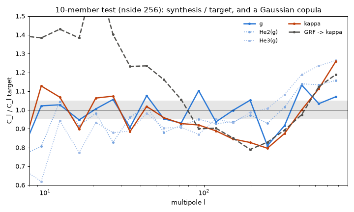
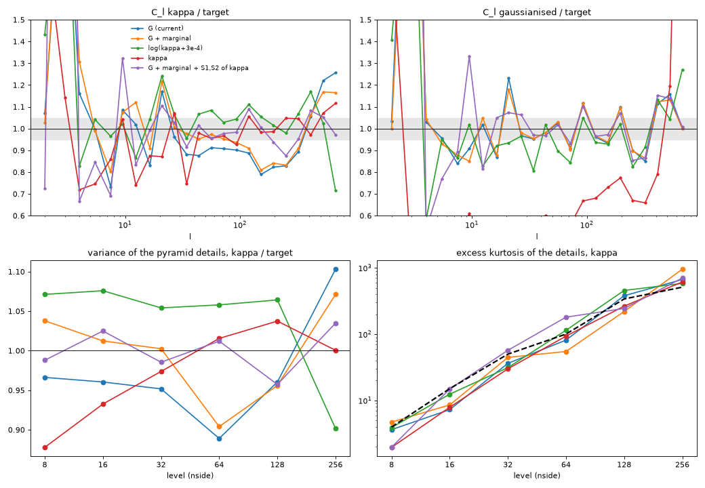
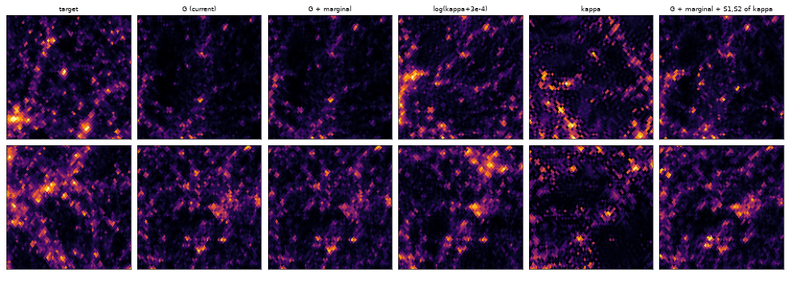
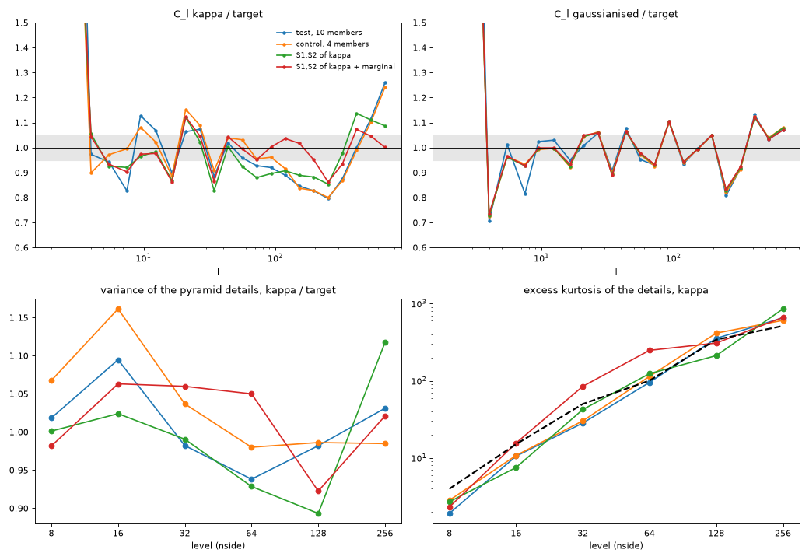
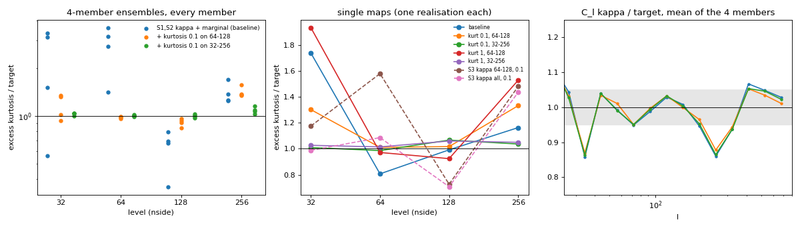

# Kappa power spectrum of gaussianised syntheses

Syntheses of the Takahashi r000 zs1 convergence map follow the recipe of
`USAGE.md` §4.2: gaussianise the target (rank to normal), synthesise the
gaussianised map `g`, map back to kappa by histogram matching.  The
10-member ensemble test at nside 256 (`--ensemble 10 --level-power-weight 10
--scatter-weight 1`, init from the nside-128 members, 200 iterations) gave a
kappa C_l 15-20 % low at l 135-284 and 26 % high at l 599-767, the same for
every member, while every family of the gaussianised statistics was at about
1 sigma per member and the variance of every pyramid level within 4 %.  This
note finds the cause and compares fixes at nside 256.

Summary: the deficit comes from the extreme tail of `g` (the halos), which
the gaussianised statistics barely weigh.  Two terms fix it:

- `--kappa-table KNOTS --kappa-families mean,var,S1,S2 --kappa-weight 0.1`:
  the first-order statistics of `kappa = f(g)` in the loss;
- `--marginal-weight 1000 B`: the pixel histogram of `g` held at the
  target's, so that `f(g)` is the map the histogram matching produces.

With both, the kappa C_l of a 4-member ensemble go from 12.5 % rms (24 % max)
to 6.6 % rms (14 % max) over l = 31-767.  The gaussianised statistics stay at
1 sigma per member.  The evaluation costs 1.8 times as much.  Cheaper ideas
were tested and fail, for reasons given in §4.

With these two terms the kurtosis of the kappa details overshoots at
intermediate scales (3 times the target's at nside 64).  A third term,
`--kurtosis-weight 0.1 B --kurtosis-nside 32-NSIDE`, holds it on every
member at 3 % of the cost, with the statistics unchanged (§7).

## 1. Diagnosis: a Gaussian copula at small scales



C_l of the synthesis over C_l of the target (mean of the 10 members of the
test run), for `g`, for Hermite polynomials of it, for kappa, and for a
Gaussian random field with exactly the target's C_l of `g` mapped through
the same table (mean of 10 realisations):

| l | g | He2(g) | He3(g) | kappa | GRF -> kappa |
|---|---|---|---|---|---|
| 31-38 | 0.91 | 0.96 | 0.89 | 0.89 | 1.23 |
| 82-105 | 1.10 | 0.95 | 0.87 | 0.92 | 0.90 |
| 135-172 | 1.00 | 0.94 | 0.93 | 0.85 | 0.85 |
| 173-221 | 1.05 | 0.97 | 0.99 | 0.83 | 0.79 |
| 222-284 | 0.81 | 0.93 | 1.01 | 0.80 | 0.83 |
| 285-364 | 0.92 | 1.02 | 1.08 | 0.88 | 0.89 |
| 468-598 | 1.03 | 1.13 | 1.24 | 1.11 | 1.12 |
| 599-767 | 1.07 | 1.16 | 1.26 | 1.26 | 1.19 |

- The deficit appears in the transform.  In `g` the ratios oscillate around
  1 from one octave to the next: the wavelet bands hold the power of each
  octave, not its shape within it.  The low-order Hermite polynomials are
  within about 10 %.
- Above l = 100 the kappa C_l of the synthesis are those of a Gaussian field
  with the right C_l of `g`.  The synthesis has a Gaussian copula at small
  scales.  (At l < 100 it does much better than the Gaussian field, which is
  20-140 % high there.)
- The kappa power at l > 100 comes from the extreme tail of `g`: 25 pixels
  above 4 sigma and 1062 above 3 sigma, out of 786432.  Their arrangement
  (extended, clustered halos) weighs almost nothing in the gaussianised
  statistics.

A single map from white noise (400 iterations, `--level-power-weight 1`,
variant G below) shows the same deficit, so screening was done on one map.

## 2. Single maps

Protocol: `stl-synth --L 4 --weights ergodic --niter 400
--level-power-weight 1` from white noise (seed 11), then `gaussianize.py
match`.  Every variant is judged on its final kappa map:

- C_l: rms and largest deviation of C_l / C_l(target) over the 13 log bands
  from l = 31 to 767;
- S residuals: rms over each family, in ergodic sigma, of the final map's
  statistics.  In gaussianised space, the kappa map is rank-gaussianised
  back, so these are the statistics of what the matching produced, not of
  the synthesis variable.  In kappa space, the target is kappa itself.  Both
  are `stl-synth --niter 0` evaluations;
- variance of the pyramid details of the rank-gaussianised map, levels 8 to
  256 (range over the levels);
- excess kurtosis of the kappa details at levels 32, 64, 128, 256 (target
  50, 100, 340, 513).

| Variant | C_l rms / max | S1-S4, g space | S1-S4, kappa space | var levels, g | kurtosis 32/64/128/256 |
|---|---|---|---|---|---|
| G (current recipe) | 0.152 / 0.256 | 0.46 0.67 3.36 1.30 | 4.96 3.39 3.70 3.67 | 1.00-1.01 | 36 / 82 / 381 / 668 |
| G + marginal | 0.116 / 0.190 | 0.39 0.35 0.60 0.41 | 5.68 2.76 2.98 2.96 | 1.00-1.01 | 45 / 55 / 220 / 957 |
| log(kappa + 3e-4) | 0.106 / 0.285 | 15.6 11.2 18.9 7.6 | 2.63 2.63 2.95 3.52 | 0.89-1.18 | 31 / 115 / 457 / 585 |
| log(kappa + 4e-3) | 0.078 / 0.146 | 64 43 31 35 | 7.0 2.1 1.7 2.1 | 0.65-1.81 | 28 / 105 / 320 / 623 |
| kappa directly | 0.088 / 0.254 | 107 72 34 43 | 15.1 2.7 1.6 1.9 | 0.51-2.19 | 30 / 94 / 265 / 615 |
| G + power per level of kappa | 0.068 / 0.128 | 0.65 0.43 1.39 0.69 | 7.84 2.40 2.61 2.54 | 1.00-1.01 | 41 / 114 / 377 / 796 |
| same + marginal | 0.109 / 0.173 | 0.40 0.36 0.62 0.41 | 6.62 2.39 2.80 2.81 | 1.00-1.01 | 24 / 59 / 206 / 985 |
| G + all families of kappa, weight 1 | 0.139 / 0.299 | 1.61 4.65 2.89 6.18 | 4.76 3.14 2.97 2.51 | 0.99-1.09 | 40 / 159 / 230 / 618 |
| G + all families of kappa, weight 0.1 | 0.126 / 0.249 | 0.80 1.25 2.66 2.35 | 4.52 3.14 3.22 2.73 | 1.00-1.02 | 41 / 124 / 288 / 622 |
| G + S1,S2 of kappa, weight 1 | 0.068 / 0.132 | 4.31 3.05 5.41 6.98 | 1.17 1.35 2.21 3.82 | 0.99-1.08 | 64 / 260 / 215 / 814 |
| G + S1,S2 of kappa, weight 0.1 | 0.066 / 0.139 | 1.89 1.87 2.37 3.81 | 1.63 1.40 2.10 3.14 | 1.00-1.02 | 78 / 167 / 261 / 847 |
| **G + S1,S2 of kappa, weight 0.1 + marginal** | **0.062 / 0.125** | **0.53 0.62 0.79 0.54** | **0.16 0.10 1.60 2.59** | **1.00-1.01** | 57 / 181 / 245 / 704 |





Gnomonic views (12 x 12 degrees, two fixed centres, asinh scale): the
syntheses are independent realisations, so only the texture compares.

Cost per evaluation: on one T4, G 1.46 s, G + S1,S2 of kappa 2.65 s (x1.8),
G + all families of kappa 3.13 s (x2.1).  On 32 CPU ranks, G + marginal
5.15 s and G + marginal + S1,S2 of kappa 9.38 s (x1.8).  The marginal term
is one sample sort per member and evaluation.

## 3. Ensembles

Protocol of the test run, with 4 members: `--ensemble 4 --groups 4
--scatter-weight 1 --level-power-weight 4 --niter 200`, init from the first
4 nside-128 members of the production chain (`--init ..._m{m}...`, noise
`auto`).  Weights per member as in production: the level-power and marginal
weights are multiplied by B.

| | test, 10 members | control, 4 members | S1,S2 of kappa | S1,S2 of kappa + marginal |
|---|---|---|---|---|
| C_l kappa, l >= 31: rms / max | 0.133 / 0.260 | 0.125 / 0.241 | 0.110 / 0.173 | **0.066 / 0.138** |
| l 135-172 / 222-284 / 599-767 | 0.85 / 0.80 / 1.26 | 0.84 / 0.80 / 1.24 | 0.89 / 0.85 / 1.09 | 1.02 / 0.86 / 1.00 |
| per member S1 S2 S3 S4 (sigma) | 1.09 0.99 1.08 1.02 | 0.98 0.91 1.00 0.93 | 0.97 0.88 1.02 0.94 | 0.98 0.90 1.03 0.95 |
| scatter / ergodic variance, S1-S4 | 1.20 0.95 1.17 1.10 | 1.08 0.87 1.09 1.05 | 1.08 0.80 1.11 1.05 | 1.08 0.82 1.11 1.05 |
| final maps (after matching), S1-S4 per member, g space | | 1.0-2.1, 1.3-2.8, 3.0-3.4, 1.5-1.9 | | 0.9-1.4, 0.7-1.3, 1.0-1.1, 0.9-1.0 |
| final maps, S1-S4 per member, kappa space | | 5.3-7.2, 2.9-5.8, 3.1-5.9, 3.2-7.2 | | 0.9-1.5, 1.1-2.3, 1.9-2.8, 2.1-4.0 |
| var of the levels in g, 8 ... 256 | 0.96-1.04 | 0.96-1.06 | 0.94-1.07 | 0.92-1.07 |
| kappa S1, S2 of the mean (sigma) | | | 0.08 0.12 | 0.15 0.15 |
| kurtosis of kappa, levels 32 / 64 (target 50 / 100) | 28 / 95 | 30 / 114 | 42 / 124 | 85 / 248 |
| s / eval, ranks | 9.4, 170 | 14.6, 40 | 16.9, 72 | 16.6, 72 |



With `--kappa-weight 0.3` (and the marginal term) the C_l improve a little
(5.6 % rms, 13.1 % max).  The levels of `g` drift, though: 0.75 at the
finest, 1.17 at 128.  0.1 is the setting.

Without the marginal term the kappa term reaches its targets (S1, S2 of kappa
at 0.1 sigma) but the C_l move little.  It gets there by moving values of
`g` off the Gaussian marginal, and the histogram matching undoes that.  In
the single maps the squared 1-D Wasserstein distance to the target's values
grows from 1.3e-4 (G) to 3.4e-3, with pixels down to g = -26.

## 4. What fails, and why

- **Correcting the C_l afterwards.**  Alternating a C_l correction (the
  ensemble-mean transfer function, smoothed in l) with histogram matching:
  8 iterations bring the test ensemble to 2.7 % rms.  The finest level of
  `g` then holds only 72 % of its variance, and the kurtosis of its details
  is 1.5 instead of 0.37.
- **Synthesising a less gaussianised field** (log(kappa + lambda), or kappa
  itself).  The deficit at l 135-284 goes, but the bulk is lost: in
  gaussianised space the final maps are 8 to 107 sigma away, and the level
  variances are off by up to a factor 2.
- **Power per level of kappa = f(g)** (the `--level-power-weight` term on
  kappa).  On its own it is met by isolated spikes far in the extrapolated
  tail of `f`: kurtosis up to x10.  With the marginal held, the level
  variances of kappa are exactly 1, but the C_l barely move (0.84-0.86 at
  l 135-284).  The Haar details have too broad a window in l to set the
  shape of the C_l.
- **All the families of kappa** (the statistics of kappa as a second loss).
  With the ergodic weights the term is a mean over its coefficients, and the
  56 S1, S2 coefficients that carry the power are lost among 5824 S3, S4
  ones.  At weight 0.1 the C_l barely improve.  At weight 1 neither term
  converges in 400 iterations.  Restricting the term to mean, var, S1, S2
  gives them all the weight, at a slightly lower cost.
- **Constant extrapolation of f beyond the table.**  Pixels pushed beyond
  the last knot get no gradient from the kappa term, and they pile up at the
  maximum: 107 pixels above 4 sigma, var of kappa 24 sigma off.  `f` is
  extrapolated linearly.

## 5. Pitfalls of the marginal term

Without it, even the current recipe loses accuracy in the histogram
matching.  The synthesis has S3 at 0.6 sigma, the final map 3.4 sigma: the
synthesised `g` has 67 pixels above 4 sigma against 25, and the matching
moves them.  With `--marginal-weight 1000` (one map) the squared 1-D
Wasserstein distance drops from 1.3e-4 to 4e-8, the final map keeps the
synthesis's residuals, and nothing else changes.  In an ensemble it makes
the members' variances identical (scatter / ergodic variance of var 0.01):
the histogram is held exactly per member.

## 6. Recommended setting

```bash
python tools/gaussianize.py forward T.npy T_gauss.npy table.npz
python tools/gaussianize.py knots table.npz knots.npy              # 256 knots of g -> kappa
stl-synth --target T_gauss.npy --L 4 --weights ergodic \
    --ensemble 10 --groups 10 --scatter-weight 1 --level-power-weight 10 \
    --marginal-weight 10000 \
    --kappa-table knots.npy --kappa-families mean,var,S1,S2 --kappa-weight 0.1 \
    --kurtosis-weight 1 --kurtosis-nside 32-$NSIDE \
    --init prev_m{m}_synthesis_nested.npy --niter 200 --out ens
python tools/gaussianize.py match table.npz ens_m000_synthesis_nested.npy ens_m000_kappa.npy   # per member
```

- `--kappa-weight` is not multiplied by B: like the main term, the kappa term
  is the reduced chi^2 of the ensemble mean.
- `--marginal-weight` is multiplied by B, like `--level-power-weight`: the
  term is `w / B sum_m W2^2(member m, target)`.
- `--kurtosis-weight` is multiplied by B too (0.1 per member): the term is
  `w / B sum_m sum_n (K_n / K_n(target) - 1)^2`.  `--kurtosis-nside 32-NSIDE`
  takes every level from the details of nside 32 to the finest (§7).

Open points:

- The largest remaining deviation is 0.86 at l 222-284, and the octave
  oscillations of the C_l of `g` (0.81 to 1.13) are unchanged.  The kappa
  statistics are dyadic too.
- The kurtosis of the kappa details at levels 32-64 overshoots (85 / 248
  against 50 / 100) without the kurtosis term: §7.
- Not yet tested at nside 1024 and 2048.  The table of knots has 256 points,
  for tails beyond 5 sigma at 2048.

## 7. Kurtosis of the kappa details at intermediate scales

With the setting of §6 the tails of the kappa details are too heavy at
intermediate scales.  `K_n = <d_n^4> / <d_n^2>^2` is the kurtosis of the
details of level n of the 4-children pyramid (as for `--level-power-weight`);
the tables give the excess `K_n - 3`.  The target's excess at the levels 32,
64, 128 and 256 is 50, 100, 340 and 513.

- In the 4-member test of §3, rerun on a T4, the medians over the members
  are at 2.3, 3.0, 0.7 and 1.3 times the target's.
- The nside-512 ensemble (10 members from the nside-256 maps) gives 63, 223,
  284, 479 and 1378 at 32 to 512 (targets 50, 100, 340, 513, 855).
- The nside-1024 test gives 86, 349 and 550 at 32, 64 and 128.

The current recipe without the kappa terms (control of §3) stays near the
target at 64 (83 to 218 over its members, median 114).  The S1, S2 of kappa
with the marginal term are what pushes the level-64 tails up.

Kurtosis is a noisy statistic, dominated by a few halos.  A jackknife over
the 12 base faces gives the target 50 ± 18, 100 ± 27, 340 ± 100 and
513 ± 64 at 32, 64, 128, 256.  Single maps are therefore a poor probe: one
white-noise realisation of the §6 setting sits at 0.8 of the target at 64,
another (§2) at 1.8.  The decisive comparison is the ensemble from the
nside-128 members, where the overshoot is systematic.

Two terms were tested:

- `--kappa-s3-weight X --kappa-s3-nside 64-128` adds the S3 of kappa (every
  `j1 <= j3`, with `j3` at nside 64 or 128: 80 coefficients) as a separate
  reduced chi^2 next to the S1, S2 one.  Without `--kappa-s3-nside`, all
  the S3 are kept.
- `--kurtosis-weight X --kurtosis-nside A-B` adds
  `X / B sum_m sum_n (K_n(f(g_m)) / K_n(target) - 1)^2` over the levels of
  nside A to B, with its exact gradient.  It costs +3 % per evaluation.

Single maps (protocol of §2 with `--marginal-weight 1000`, final kappa maps;
S residuals in sigma):

| Variant | kurtosis / target, 32 64 128 256 | C_l rms / max | S1-S4, g space | S1-S4, kappa space |
|---|---|---|---|---|
| §6 setting | 1.74 0.81 0.99 1.16 | 0.074 / 0.153 | 0.57 0.63 0.81 0.54 | 0.17 0.10 1.71 2.69 |
| + kurtosis 0.1, 64-128 | 1.30 1.01 1.02 1.33 | 0.070 / 0.131 | 0.47 0.55 0.76 0.53 | 0.08 0.10 1.59 2.37 |
| + kurtosis 0.1, 32-256 | 1.01 0.99 1.07 1.04 | 0.079 / 0.151 | 0.66 0.70 0.84 0.57 | 0.09 0.16 1.69 2.45 |
| + kurtosis 1, 64-128 | 1.93 0.97 0.92 1.53 | 0.079 / 0.164 | 0.87 0.85 0.85 0.67 | 0.23 0.24 1.65 2.41 |
| + kurtosis 1, 32-256 | 1.03 1.01 1.06 1.05 | 0.081 / 0.161 | 1.04 1.03 1.01 0.80 | 0.42 0.33 1.78 2.91 |
| + kurtosis 10, 64-128 | 1.92 0.96 0.96 1.23 | 0.096 / 0.193 | 2.17 1.94 1.42 1.19 | 2.02 1.27 2.63 3.66 |
| + S3 of kappa 0.1, 64-128 | 1.17 1.58 0.73 1.48 | 0.070 / 0.137 | 0.99 0.89 0.97 0.80 | 0.21 0.44 1.64 2.36 |
| + S3 of kappa 1, 64-128 | 0.87 1.03 0.88 1.27 | 0.169 / 0.336 | 7.32 6.20 2.78 1.80 | 5.92 3.13 4.33 6.31 |
| + S3 of kappa 0.1, all levels | 0.99 1.09 0.71 1.43 | **0.057 / 0.100** | 0.52 0.58 0.88 0.67 | 0.33 0.20 **0.46 1.72** |

Ensembles (protocol of §3 with the marginal term and the S1, S2 of kappa;
kurtosis weights per member, 0.4 for B = 4):

| | §6 setting | + kurtosis 0.1, 64-128 | **+ kurtosis 0.1, 32-256** | + S3 of kappa 0.1, 64-128 |
|---|---|---|---|---|
| kurtosis 32, members (target 50) | 157 76 28 167 | 67 66 47 51 | **52 50 52 52** | 72 37 103 117 |
| kurtosis 64 (target 100) | 276 362 142 317 | 100 98 97 100 | **103 100 102 101** | 213 151 449 98 |
| kurtosis 128 (target 340) | 122 237 270 229 | 328 286 318 308 | **351 335 329 344** | 271 166 171 160 |
| kurtosis 256 (target 513) | 871 648 706 641 | 700 802 690 702 | **559 594 527 547** | 637 1068 767 960 |
| median / target, 32 64 128 256 | 2.32 2.95 0.68 1.32 | 1.17 0.98 0.92 1.37 | **1.03 1.01 1.00 1.08** | 1.75 1.81 0.50 1.68 |
| C_l kappa, l >= 31: rms / max | 0.068 / 0.142 | 0.059 / 0.131 | 0.065 / 0.137 | 0.067 / 0.131 |
| per member S1 S2 S3 S4 (sigma) | 0.97 0.89 1.03 0.95 | 0.96 0.88 1.03 0.94 | 0.97 0.88 1.04 0.95 | 1.03 0.97 1.06 0.98 |
| scatter / ergodic variance, S1-S4 | 1.04 0.78 1.13 1.05 | 1.05 0.82 1.12 1.04 | 1.05 0.79 1.12 1.04 | 1.00 0.81 1.13 1.07 |
| final maps, S1-S4, g space | 1.04 0.97 1.05 0.95 | 1.15 1.08 1.03 0.95 | 1.02 0.94 1.04 0.95 | 1.07 1.03 1.06 0.98 |
| final maps, S1-S4, kappa space | 1.16 1.50 2.37 2.87 | 1.25 1.75 2.40 2.91 | 1.50 1.84 2.53 3.01 | 1.44 1.48 2.15 2.46 |
| var of the levels in g, 8 ... 256 | 0.87-1.09 | 0.89-1.08 | 0.85-1.09 | 0.68-1.27 |
| peaks above 8 sigma at 128 / 64, over target | 0.86 / 0.89 | 0.84 / 0.96 | 0.70 / 0.95 | 1.10 / 0.96 |
| s / eval (4 members, one T4) | 5.70 | 5.80 | 5.87 | 6.41 |

Peaks are the local maxima of the kappa map at the levels 256, 128 and 64
of the pyramid, counted above nu sigma (sigma of the target's map at that
level, nu = 2 to 8).  At 256 every variant is within 7 % of the target.
At 128 there are 15-20 % too many low peaks (nu 2 to 3), at 64 too few
(nu 4 to 6: 0.81-0.93).  The kurtosis term leaves them, except fewer
high peaks at 128 with 32-256.



What works, and what does not:

- **The kurtosis term holds exactly the levels it is given, and only
  those.**  Restricted to 64-128 it fixes both levels on every member and
  pulls 32 down with them in the ensemble.  256 stays 1.4 times too high.
  In single maps it moves the excess to 32 and 256, more so at weight 1
  (1.9 and 1.5).  On 32-256 every level ends within 8 % of the target.
- **Weight 0.1 per member is the scale.**  At 1 the statistics of g rise to
  about 1 sigma in single maps, at 10 to 2 sigma.  At 0.1 they do not move
  in the ensemble.  Only the per-member S1, S2 of kappa of the final maps
  rise a little (1.16 / 1.50 to 1.50 / 1.84 sigma).
- **The targeted S3 of kappa does not hold the kurtosis.**  It is met
  (0.16 sigma at weight 0.1), but the level-64 kurtosis of that realisation
  goes to 1.6 times the target's.  At weight 1 it is met by distorting the
  bulk: S1, S2 of g at 7 sigma.  In the ensemble (weight 0.1) the
  kurtosis stays 1.8 times too high at 32 and 64 and halves at 128.  The
  levels of g drift (0.68 at the finest, 1.27 at 128), and there are 27 %
  too many peaks at 128.  S3 is a mean over the sky of the coupling between
  scales, which a few halos barely move.  The kurtosis is set by those
  halos.
- **The S3 of kappa at every level** (weight 0.1, separate chi^2) is the
  best single map for the C_l (5.7 % rms) and for the S3, S4 of kappa (0.46,
  1.72 sigma), without the kurtosis.  Not tried in an ensemble yet.

Recommended: add `--kurtosis-weight 0.1 B --kurtosis-nside 32-NSIDE` to §6
(every level from the details of nside 32 to the finest; levels of a range
beyond the map's nside are ignored).

Caveats:

- Each member is held at the target's own realisation of a noisy statistic
  (± 27 at 64), so the members keep no scatter of their kurtosis (32-256:
  50-52 at 32 for 4 members).  A term on the mean over the members would
  keep it, if that matters.
- Tested at nside 256 only.  At 512 the finest level is 1.6 times too high
  as well (1378 against 855), which 32-NSIDE covers.
