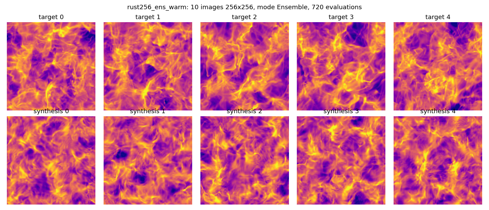
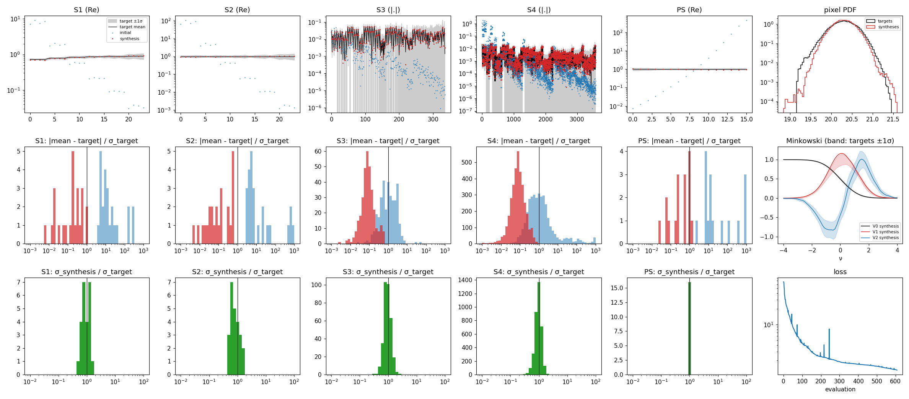

# Planar (2D) images: the block-wise pyramid in Rust

Question: can a synthesis of planar images, such as STL-Dev's 2D example
(10 images of 256 x 256 from `data/test/Turb_6.npy`), benefit from the
pyramidal gradient and from Rust, as the HEALPix syntheses do?

Short answer: **yes, mostly through Rust at 256^2, and through the pyramid
beyond.**  For the example itself (10 x 256^2), the Rust engine evaluates
STL-Dev's loss and gradient in 0.46 s on 12 CPU cores with 0.3 GB, against
5.0 s and 4.5 GB for STL-Dev on the same cores (11x faster, 15x less
memory).  On a T4 the Rust engine takes 0.18 s, against 0.64 s for
STL-Dev on the same T4 (3.5x).  Memory is not the issue at that size; it
becomes the issue quickly: STL-Dev's autograd keeps about 7-9 KB per
pixel (CPU) and does not fit a 15 GB T4 at one 2048^2 image, while the
block-wise engine stays near 0.2-0.4 KB per pixel: one 4096^2 image in
29 s with 2.9 GB on the CPU, in 4.9 s with 1.9 GB on a T4.  The Rust
results match STL-Dev to 1e-10, the device ones the CPU ones to 1e-12,
and a full 100-iteration synthesis reproduces STL-Dev's loss history to
3e-8.

Code: `stl_core::planar` (`kernels`, `grid`, `engine`, `spectrum`),
`stl_gpu::planar` and `planar.cu` (the device engine, section 5b),
`stl_cli::planar` and the binary `stl-synth2d`; fixtures
`fixtures/planar` from `tools/dump_planar_reference.py`; tests
`crates/stl-core/tests/planar.rs`, `crates/stl-cli/tests/planar.rs`,
`crates/stl-gpu/tests/planar.rs`; benchmarks `tools/garoupe/bench_planar.sh`,
`bench_planar_sc.sh`, `bench_planar_gpu.sh`, `tools/bench_planar_torch.py`;
syntheses `tools/garoupe/synth_planar.sh`,
`tools/run_planar_torch_synthesis.py`; figures `tools/plot_planar.py`.

## 1. The STL-Dev reference (branch `HealpixUpdate`)

`STL_main/STL_2D_Kernel_Torch.py` (data class `STL_2D_Kernel_Torch`,
wavelet operator `WaveletOperator2Dkernel_torch`, spectrum operator
`CS_operator_2D_Kernel_Torch`), `ST_Operator.apply`,
`ST_Statistics.to_norm / to_flatten` and `Synthesis.synthesize_from_maps /
optimize_from_maps`.  Defaults of the example: `pbc=True`, `L = 4`,
`kernel_size = 5`, `J = log2(min(H, W)) - 2` (6 at 256^2), scale `j` at
level `dg(j) = j`, power spectrum on, `mean_field=True`.

**Wavelet.** One complex 5 x 5 kernel per orientation, the same at every
level and for every image size: the Bump-Steerable Fourier bank of
`WaveletOperator2D_FFT_torch` on a 256 x 256 grid at scale 0,

    psi_l(w) = exp(-2.5 r^2 / (1 - 2.5 r^2)) 1{r < 2.5^-1/2} cos(theta)^(L-1) 1{|theta| < pi/2},
    r = | |w| - xi0 | / xi0,  xi0 = 256 / (2 sqrt 2),

with `w` the integer frequency grid rotated by `pi l / L + pi / 2` and
`theta` its angle; inverse FFT, `fftshift`, central 5 x 5 crop, mean
removed.  The bank is built in float32 (`torch.empty` with torch's default
dtype) and cast to complex128 after the crop, so the Rust port stores the
100 dumped taps (`planar::kernels::WAVELET`) instead of recomputing them.

**Convolution.** `F.conv2d` (a cross-correlation) after circular padding
by 2: `z_l[i, j] = sum_ab psi_l[a, b] x[i + a - 2, j + b - 2]` (indices
modulo the image), real and imaginary parts separately.

**Decimation.** `_downsample_tensor`: circular padding by 2 before and 3
after, `F.conv2d` with the 6 x 6 cropped raised-cosine kernel of
`_get_smooth_kernel` (bandwidth 0.71, beta 0.35, 8 digits), stride 2:
`y[i, j] = sum_ab s[a, b] x[2i + a - 2, 2j + b - 2]`.  `maps[d] = D^d x`.

**Statistics** (`norm="vanilla"`; with `pbc=True` nothing is cropped and
every mean is over the whole level).  With `z_n = psi * maps[n]`,
`m[d][n] = D^(n-d) |z_d|` and `n = j3`:

| family | definition (c1 = c2) | cross channels |
|---|---|---|
| mean, var | `<x>`, `<x^2>` (no mean removed) | - |
| S1(j, l) | `<|z_j|>` | `<rn(z_c1) conj rn(z_c2)>`, `rn(z) = z / sqrt(|z| + 1e-8)`, `c1 < c2` |
| S2(j, l) | `<|z_j|^2>` | `<z_c1 conj z_c2>`, `c1 < c2` |
| S3(j1 <= j3, l1, l3) | `<(psi_l3 * m[j1][j3]_l1) conj z_j3,l3>` | both orders |
| S4(j1 <= j2 <= j3, l1, l2, l3) | `<(psi_l3 * m[j1][j3]_l1) conj (psi_l3 * m[j2][j3]_l2)>` | both orders |

`has_fewer_convolutions` replaces the first operand of S3 by
`maps[j3]` (and conjugates the other way) and that of S4 by
`m[j1][j3]_l1`.  At 256^2, `J = 6`: 1 + 1 + 24 + 24 + 336 + 3584
coefficients, plus 16 power-spectrum bins.

**Power spectrum** (`gaussian_rings`, `pbc=True`): `X = fft2(x, ortho)`,
radial frequency `f` in cycles per pixel (computed in float32 by
`torch.fft.fftfreq`), `n_bins = 2^(log2(min) - 4)` (16 at 256^2) log-spaced
edges from `1 / 2^J` to `0.5`, Gaussian rings in `log f` of width the bin
width, zero at `f = 0`:
`PS_j = sum_k m_j(k) X_c1(k) conj X_c2(k) / sum_k m_j(k)`.

**Loss** (`optimize_from_maps`, `mean_field=True`).  The targets are
Nyquist-filtered (modes with `k_r^2 + k_c^2 > (N/2)^2` removed) and
standardised by the batch mean and the batch root mean square of the
centred maps.  `store_ref` normalises with the batch means of the target
statistics: `var / var_ref`, `S1 / sqrt(r_c1 r_c2)`, `S2 / (r_c1 r_c2)`,
`S3 / (r_c1(j1, l1) r_c2(j3, l3))`, `S4 / (r_c1(j1, l1) r_c2(j2, l2))`
with `r = sqrt(mean_b S2(c, c))`, and `PS / (p_c1 p_c2)` with
`p = sqrt(mean_b PS(c, c))`; then S3 is multiplied by 3.5 and S4 by 3.5^2
(`adhoc_weights`), every statistic is averaged over the batch, and

    L(u) = sum_i | mean_b f_i(u_b) - mean_t f_i(t) |^2

over the `B` running images `u_b` (`nbatch`, independent of the number of
targets).  The variable is `u` itself, in standardised units, initialised
by `torch.randn` (seed 26) Nyquist-filtered.  `torch.optim.LBFGS`, lr 1,
100 iterations, history 50, strong Wolfe, tolerances 1e-12 / 1e-15.

## 2. The Rust port: the pyramid on a periodic grid

`stl_core::planar::engine::PlanarEngine` is `LocalScattering.LocalEngine`
on the planar operators, as planned in STL-Dev's
`docs/Pyramide_gradient_par_patch.md`:

- each level is cut into square tiles `F` (`--tile`, clipped to the
  level); `z_n` is computed on `a1 = F + 2` from `maps[n]` read on `F + 4`
  (indices modulo the level: a tile at the border simply wraps); the
  stored moduli `m[d][n]` of the finer levels are read on `a1`; the second
  wavelets are evaluated on `F`; partial sums of all coefficients of native
  level `n` accumulated;
- `|z_n| . 1_F` is pushed to every coarser level through decimation
  pieces: the coarse rows touched by fine rows `[r0, r0 + h)` are
  `ceil((r0 - 3) / 2) ..= floor((r0 + h + 1) / 2)`, folded onto the whole
  axis as soon as they would wrap, so that the pixels of a piece are
  distinct and the pushed values exact;
- the reverse sweep recomputes the tile fields, applies the coefficient
  cotangents, accumulates `gm[d][n]` (complete when level `d` is reached
  since the coarser levels are done first), pulls the tile's own chain
  from `gm[n][n']` through the transposed pieces (Horner-wise from the
  coarsest level), then the modulus VJP and the wavelet adjoint give the
  cotangent of `maps[n]`; the map cotangents of all levels are chained back
  to level 0 through the transposed whole-level decimations.

Tiles of a level run on host threads by groups (results added in tile
order, so the sums do not depend on the number of threads); the images of
a batch run side by side (`stl_cli::planar`).

Memory per image: the maps and their cotangents (`2 x 4N/3` values), the
stored moduli and their cotangents (`2 x 4N/9 x L`), and per running tile
its fields (`|F + 4|` real, `L |F + 2|` complex, `L^2 |F|` complex per finer
level).  The planar operators need no geometry at all: what dominated the
memory and half the time on the sphere (HEALPix stencils, interpolation
weights, decimation matrices) does not exist here.

## 3. Exactness against STL-Dev

`tools/dump_planar_reference.py` (STL-Dev `HealpixUpdate`, torch 2.7.1,
float32 default dtype as in STL-Dev's own use) writes 11 cases:

- `kernels`: wavelet and smoothing taps, equal bit for bit;
- `ops_*`: one convolution, one decimation and their adjoints on 16 x 24
  and 32 x 8 maps: 1e-13 relative;
- `stats_*`: raw statistics and the gradient of `Re sum conj(g) S` for
  random complex `g`, 16^2 to 64^2, `J = 2..4`, 1 and 2 channels, both
  S3/S4 definitions: agreement better than 1e-11 absolute + 1e-10
  relative (statistics) and 1e-10 of the largest component (gradients),
  for tiles of the whole level, 8 and 4 pixels, 1 and 3 threads; power
  spectra and their gradients to 1e-11;
- `loss_64_t4_b3`: STL-Dev's complete loss (prefilter, standardisation,
  normalisation, weights, spectra, batch mean) for 4 targets and 3 running
  images of 64^2: loss and gradient at the initial maps to 1e-10, and the
  12 evaluations of a 10-iteration L-BFGS to 1e-7.

The ensemble objective (section 4) is checked against central finite
differences (`stl-cli/tests/planar.rs`).

Over a whole synthesis (section 6), `stl-synth2d --mode stldev` started
from STL-Dev's own initial maps reproduces STL-Dev's 100-iteration L-BFGS
(torch on a T4): the same 108 evaluations, relative differences of the
loss 1e-14 at the start, 5e-11 at evaluation 90, 3e-8 at the end (final
loss 0.0997114998 vs 0.0997115027).

## 4. Loss with Minkowski functionals and power spectrum

`stl-synth2d --mode ensemble` (default) is the ensemble objective of the
HEALPix runs (`stl-ensemble`) on the plane, with the same loss code
(`ensemble::losses`):

    L = w_sc L_SC + w_ps L_PS + w_mf L_MF   (weights 1 by default)

- `L_SC`: the ScatCov features normalised as in STL-Dev (without the
  ad-hoc S3/S4 weights), `sc_loss` in its Gaussian form: mean over the
  coefficients of `|mu - t|^2 / v_t` plus the variance-ratio term
  `mean log(v / v_t)^2`, with `mu`, `v` the mean and variance over the
  `B` synthesised images and `t`, `v_t` over the targets;
- `L_PS`: the Gaussian-ring auto-spectra (normalised), `power_loss`
  (`10 mean (log mu - log t)^2 + 2.5 mean log((v + e) / (v_t + e))^2`,
  every bin);
- `L_MF`: the soft Minkowski functionals V0, V1, V2 of every standardised
  image at 65 thresholds in [-4, 4] (`ensemble::fields::Minkowski`, now
  generic over a `Derivatives` trait: harmonic derivatives on the sphere,
  spectral derivatives here), `mf_loss`.

`--mode stldev` keeps STL-Dev's loss exactly (section 1), for the
comparisons.

## 5. Benchmark (garoupe: 2 x Xeon Bronze 3204, 12 cores, Tesla T4)

Seconds per evaluation (statistics, loss and gradient of the batch) and
peak memory, STL-Dev's loss in both codes (`--mode stldev`), median of
the last two of three evaluations.  torch 2.7.1, float64, 12 threads on
the CPU; STL-Dev on one T4 (FP64 is 1/32 of FP32 there).  Rust 12 threads,
tiles of 64 unless stated.

STL-Dev's complete loss (ScatCov and power spectrum).  CPU columns: peak
resident memory; T4 columns: peak device memory (for Rust, everything in
use on the device, CUDA context included):

| images | STL-Dev CPU (12 threads) | Rust CPU (12 threads, tiles 64) | STL-Dev T4 | Rust T4, fastest | Rust T4, smallest |
|---|---|---|---|---|---|
| 10 x 256^2 (the example) | 5.0 s, 4.5 GB | **0.46 s, 0.30 GB** | 0.64 s, 2.8 GB | **0.18 s, 0.31 GB** (tiles 64) | same |
| 10 x 512^2 | 31 s, 14.3 GB | **1.9 s, 0.82 GB** | 2.2 s, 11.9 GB | **0.69 s, 1.39 GB** (tiles 256) | 0.70 s, 0.48 GB (tiles 64) |
| 1 x 1024^2 | 34 s, 9.2 GB | **1.3 s, 0.43 GB** | 1.1 s, 7.2 GB | **0.29 s, 0.38 GB** (tiles 256) | 0.45 s, 0.28 GB (tiles 64) |
| 1 x 2048^2 | 79-294 s, 41.9 GB | **5.2 s, 0.82 GB** | out of memory (15 GB) | **1.18 s, 0.72 GB** (tiles 256) | 1.92 s, 0.55 GB (tiles 64) |
| 1 x 4096^2 | (would need ~150 GB) | **29 s, 2.9 GB** | - | **4.9 s, 1.9 GB** (tiles 256) | 8.2 s, 1.7 GB (tiles 64) |

(The ensemble objective of section 4 adds the Minkowski functionals and
the spectra of every image: 0.83 s / 0.46 GB at 10 x 256^2 and 3.5 s / 1.5 GB
at 10 x 512^2 on the CPU; 0.30 s and 1.14 s on a T4, everything resident.)

Effect of the tile size in Rust (STL-Dev loss):

| images | tile 16 | 32 | 64 | 128 / 256 | whole level |
|---|---|---|---|---|---|
| 10 x 256^2 | 0.60 s, 0.21 GB | 0.46 s, 0.19 GB | 0.48 s, 0.30 GB | 0.52 s, 0.48 GB (128) | 0.60 s, 0.80 GB |
| 1 x 1024^2 | | | 1.34 s, 0.43 GB | 2.9 s, 0.86 GB (256) | 8.2 s, 1.2 GB |
| 1 x 2048^2 | | | 5.2 s, 0.82 GB | 8.6 s, 1.65 GB (256) | 39 s, 4.3 GB |
| 1 x 4096^2 | | | 29 s, 2.9 GB | 30 s, 3.5 GB (256) | 171 s, 16.4 GB |

Tiles of 32-64 pixels are the fastest as well as the smallest: whole-level
fields (one tile per level, i.e. the classical full-domain computation in
the same code) fall out of the caches.  The remaining Rust memory is
mostly not the engine (maps, stored moduli and their cotangents are about
50 bytes per pixel) but the copies of the target images and the FFT
buffers of the spectrum.

STL-Dev stores the `n_bins x H x W` ring masks of the spectrum (128 x
2048^2 x 8 bytes = 4 GB, 34 GB at 4096^2); the Rust version computes the
weights of a pixel when needed, for the bins within 12 widths (weights
dropped below 5e-32).

ScatCov-only loss (`compute_PS=False` / `--bins 0`,
`tools/garoupe/bench_planar_sc.sh`, `bench_planar_gpu.sh`).  The 256^2 CPU
row was measured on an idle machine; the other CPU rows while another job
loaded garoupe's cores (load 6-16), so the torch CPU times there (98 s at
10 x 512^2, 54 s at 1 x 1024^2, slower than with the spectrum on the idle
machine) are upper bounds.  The T4 runs are on otherwise idle devices:

| images | STL-Dev CPU | Rust CPU | STL-Dev T4 | Rust T4, fastest | Rust T4, smallest |
|---|---|---|---|---|---|
| 10 x 256^2 | 5.4 s, 4.3 GB | **0.43 s, 0.17 GB** | 0.53 s, 2.8 GB | **0.17 s, 0.25 GB** (tiles 64) | same |
| 10 x 512^2 | (loaded) | 1.8 s, 0.38 GB | 1.75 s, 11.1 GB | **0.65 s, 1.25 GB** (tiles 256) | 0.66 s, 0.38 GB (tiles 64) |
| 1 x 1024^2 | (loaded) | 1.39 s, 0.34 GB | 0.90 s, 4.4 GB | **0.26 s, 0.32 GB** (tiles 256) | 0.43 s, 0.18 GB (tiles 64) |
| 1 x 2048^2 | - | 5.1 s, 0.72 GB | - | **1.03 s, 0.52 GB** (tiles 256) | 1.79 s, 0.35 GB (tiles 64) |
| 1 x 4096^2 | - | 21-25 s, 2.4 GB | - | **4.2 s, 1.2 GB** (tiles 256) | 7.4 s, 0.99 GB (tiles 64) |

The ScatCov is most of the cost: the spectrum adds 5-16 %.

## 5b. The engine on a GPU

`stl_gpu::planar::GpuPlanar` runs the same sweeps on one CUDA device for
the whole batch at once (images, channels and orientations are planes of
every kernel).  New kernels (`planar.cu`) are all gathers, so the results
do not depend on the launch: the periodic convolution and its adjoint, the
read of a window and its deterministic accumulation (a window longer than
the level adds its repeated pixels in order), the decimation pieces and
their adjoint.  The coefficient sums and their cotangents reuse the
kernels of the HEALPix engine (`coef_partial`, `coef_reverse`).
`GpuPlanarTerms` computes the spectra and the Minkowski functionals on the
device too: a 2D FFT from batched 1D cuFFT transforms and transpositions,
the ring sums and their VJP (`pl_rings`, `pl_rings_vjp`), the spectral
derivatives (`pl_spec_mult`), and the Minkowski kernels of the HEALPix
terms (`mk_*`).  `stl-synth2d --gpu` (feature `gpu`) evaluates the running
batch there; only the losses stay on the host.

Two settings of the same code: one tile per level (`--tile` larger than
the image) keeps whole-level fields resident; small tiles bound the device
memory by the maps, the stored moduli and one tile's fields.  On the T4,
tiles of 256 are as fast as whole levels (or faster, from 512^2 on) at a
fraction of the memory; whole levels run out of the T4's 15 GB at 4096^2.
Tiles of 64 save more memory (from 11 % at 4096^2 to 65 % at 10 x 512^2)
for up to 1.7x the time.

Exactness: `stl-gpu/tests/planar.rs` (statistics and gradients against the
CPU engine to 1e-12: 16^2 to 64^2, J = 2-4, 1-2 channels, both S3/S4
definitions, batches of 1-3, whole-level tiles and tiles of 8) and
`stl-cli/tests/planar.rs` `device_objective_matches_host` (the loss and
gradient of both objectives, spectra and Minkowski functionals included,
to 1e-12).  Both fail rather than skip without a device (`STL_GPU_SKIP=1`
skips them).  The T4 losses of the benchmark equal the CPU ones to 13-15
digits.

## 6. Synthesis of the example

Target: the first 10 images of `Turb_6.npy` (256^2, periodic), 10
images synthesised, J = 6, L = 4, 16 spectrum bins (`tools/garoupe/synth_planar.sh`).

**STL-Dev's loss, 100 iterations** (`--mode stldev`, from STL-Dev's initial
maps): 108 evaluations, 69 s (0.64 s per evaluation with the L-BFGS
bookkeeping; STL-Dev on the T4: 76 s), loss 3.0e5 -> 0.0997.  The batch
mean of every normalised coefficient is within 0.1 sigma of the target
mean (median), sigma being the scatter of the 10 targets (S4: 99.9 % within
1 sigma).  `docs/figures/planar_rust256_stldev_{maps,stats}.png`.

**Ensemble objective** (`--mode ensemble`: ScatCov + power spectrum +
Minkowski, batch mean and variance).  From white noise it converges
slowly: after 515 evaluations the loss is still 145 (Minkowski mean term
98), S1/S2/spectrum 8-24 sigma off
(`planar_rust256_ens_stats.png`).  With a warm start of 100 iterations on
STL-Dev's loss (`--warm 100`, 111 evaluations, which is well conditioned)
then 500 iterations on the ensemble objective (609 evaluations, 0.95 s
each), the loss goes 66.8 -> 1.31 (SC 0.33, power 0.045, Minkowski 0.94):

| family | coefficients | median pull, white noise | median pull, synthesis | within 1 sigma | sigma_synth / sigma_target (median) |
|---|---|---|---|---|---|
| S1 | 24 | 10.7 | 0.19 | 96 % | 0.87 |
| S2 | 24 | 6.2 | 0.09 | 100 % | 0.81 |
| S3 | 336 | 1.0 | 0.08 | 100 % | 0.91 |
| S4 | 3584 | 0.96 | 0.08 | 99.9 % | 0.96 |
| PS | 16 | 11.8 | 0.38 | 81 % | 1.00 |

(pull = |batch mean - target mean| / target scatter).  The scatter between
the synthesised images matches the scatter between the targets to 10-20 %,
which the STL-Dev loss (batch mean only) does not constrain.  Visible
residuals: V1 and V2 slightly outside the targets' band near the median
threshold, and the low tail of the pixel PDF less populated than the
targets'.

## 7. Answer

- **Rust, at the example's size: about 10x on the same CPU cores**, and as
  fast as STL-Dev on a T4 without a GPU (0.46 s vs 0.64 s); on the same T4,
  3.5x faster than STL-Dev (0.18 s vs 0.64 s) with 9x less device memory.
  The gain is explicit gradients (no autograd graph, no stored
  intermediates), fused loops and no Python overhead; the operators are the
  same to 1e-10.
- **The pyramid, as images grow.**  STL-Dev's memory grows as 7-9 KB per
  pixel on the CPU and 4-7 KB on the GPU (autograd keeps every wavelet
  field, `L^2` second wavelets per finer level, of the whole image): one
  2048^2 image needs 42 GB of host memory, does not fit a T4, and a 4096^2
  image (~150 GB) fits nowhere.  The block-wise engine keeps only the
  maps, the stored moduli and their cotangents for the whole image (about
  50 bytes per pixel) plus a few tiles: 4096^2 in 2.9 GB and 29 s per
  evaluation on 12 cores, 1.9 GB and 4.9 s on a T4, i.e. a 500-iteration
  synthesis in about 45 minutes on one T4 (an FP64-weak device: an A100
  should be several times faster).  The time is linear in the number of pixels (0.46 s per
  0.65 Mpix, 29 s per 16.8 Mpix), which STL-Dev's CPU path is not
  (paging from 2048^2).
- **Why it is simpler than on the sphere:** the planar operators need no
  geometry, so the tile fields are the whole cost; the tiles are
  independent, so the same engine distributes over MPI ranks with the
  HEALPix decomposition (owned tiles, ghost accumulation of the pieces)
  when an image does not fit a node, which no planar case here requires.
- **Synthesis quality:** the STL-Dev loss converges in 100 iterations as in
  STL-Dev; the ensemble loss (ScatCov + spectrum + Minkowski, mean and
  variance) is best started from it (`--warm 100`).

## 8. Not done

- `pbc=False` (replicate padding and the cropped means of
  `_get_crop_border_size_fully_flexible`): only periodic images are ported;
- masks / NaN-aware decimation, the Morlet wavelet, the legacy spectrum;
- the GPU engine on several devices or ranks (one device per process for
  now);
- MPI: the tiles of a level are independent, so the HEALPix
  decomposition (owned tile ranges, ghost accumulation of the pieces)
  carries over directly if images beyond one node's memory are needed.
