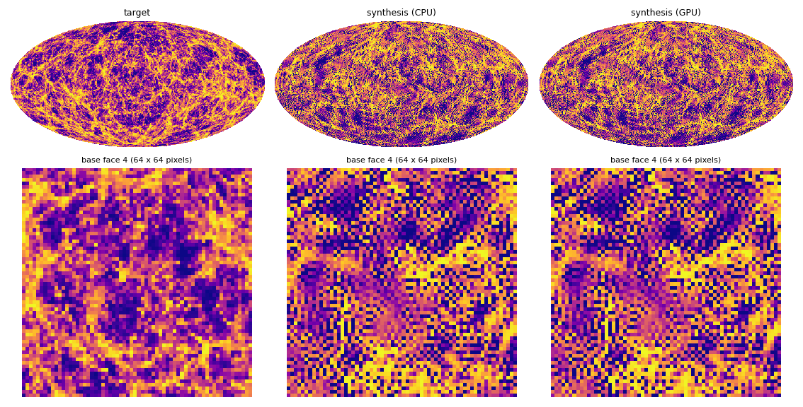
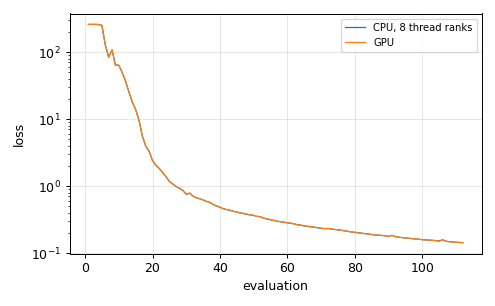

# HEALPix synthesis of one map, on CPU and GPU

Synthesis of a map whose scattering-covariance statistics match those of a target: the
weak-lensing convergence κ of Takahashi et al. (2017), realisation r000 at source redshift zs1,
block-averaged to nside 64 (`fixtures/takahashi/takahashi_r000_zs1_nside64_nested.npy`, NESTED,
shipped with the repository), starting from white noise, with `stl-synth`.

```bash
cargo build --release -p stl-cli --features gpu      # without a GPU: no feature, and GPU=0
bash examples/01_healpix_synthesis/run.sh            # NITER=100 RANKS=8 GPU=1 by default
```

The commands it runs:

```bash
stl-synth --target takahashi_r000_zs1_nside64_nested.npy --L 4 --weights ergodic --niter 100 --seed 1 --ranks 8 --out out/cpu
stl-synth --target takahashi_r000_zs1_nside64_nested.npy --L 4 --weights ergodic --niter 100 --seed 1 --gpu --out out/gpu
```

- `--L 4`: four orientations (the default; two leave anisotropic textures);
- `J` defaults to `log2(nside) − 1 = 5` scales, the kernel to 5 × 5: 2522 coefficients;
- `--weights ergodic`: each squared residual is divided by the target's spatial variance of that
  coefficient, so the loss is a reduced χ² and every family is fitted;
- `--ranks 8`: eight ranks as threads of one process (with the `mpi` feature, use `mpirun -n 8`
  instead: [example 05](https://github.com/jmdelouis/STL-Dev-MPI/tree/main/examples/05_mpi));
- `--gpu`: one CUDA device.

## Results



Top: Mollweide views; bottom: one base face (64 × 64 pixels). All panels share one
histogram-equalised colour scale, set by the target (healpy's `norm='hist'`). At nside 64 (pixels of
0.9°) the Takahashi κ map is strongly non-Gaussian (pixel skewness 8.4): filaments and halos on
voids. The syntheses reproduce the filamentary network, and their statistics match the target's
(reduced χ² 0.14, [example 03](https://github.com/jmdelouis/STL-Dev-MPI/tree/main/examples/03_statistics)). They also keep pixel-scale noise, because a
direct synthesis of so skewed a field from white noise in 100 iterations does not settle the
smallest scales. The recipe for such fields (Gaussian anamorphosis, synthesis at `2N`,
histogram matching; [USAGE](../../docs/USAGE.md), section 4) and the ensemble method of
[example 02](https://github.com/jmdelouis/STL-Dev-MPI/tree/main/examples/02_healpix_ensemble) give clean maps.



| Run | Evaluations | s / evaluation | Optimisation | Wall clock (setup included) | Loss | Peak memory |
|---|---|---|---|---|---|---|
| CPU, 8 thread ranks | 112 | 3.58 | 401 s | 404 s | 259.2 → 0.1429 | 0.42 GiB host |
| GPU (Tesla T4) | 112 | 0.043 | 4.8 s | 22 s | 259.2 → 0.1429 | 0.31 GiB host, 0.51 GiB device |

garoupe: 2 × Xeon Bronze 3204 (12 cores at 1.9 GHz), Tesla T4 (whose FP64 is 1/32 of its FP32).
The two runs follow the same trajectory: the final losses agree to 2.3e-8 relative (the GPU and CPU gradients differ by about 1e-12, which
L-BFGS amplifies slowly; see the [GPU report](../../docs/gpu.md), section 5).

## Outputs (`out/`)

| File | Content |
|---|---|
| `cpu.json`, `gpu.json` | run report: `loss_history`, `seconds_per_evaluation`, `timers_seconds`, `memory_peak_bytes_per_rank`, `final_residual_in_ergodic_sigma` per family, ... |
| `*_synthesis_nested.npy` | the synthesis in the target's units |
| `*_synthesis_standardized.npy` | the same, standardised |
| `*_synthesis.fits`, `*_target.fits` | HEALPix FITS binary tables |

## Going further

- Non-Gaussian targets (weak lensing at low redshift, density): Gaussian anamorphosis, synthesis
  at `2N`, histogram matching ([USAGE](../../docs/USAGE.md), section 4).
- Large nside: coarse-to-fine starts (`--init` from a lower-nside synthesis), MPI ranks or several
  GPUs ([MPI guide](../../docs/user-guide/mpi.md), [GPU guide](../../docs/user-guide/gpu.md)).
- Statistics of the result: [example 03](https://github.com/jmdelouis/STL-Dev-MPI/tree/main/examples/03_statistics).
