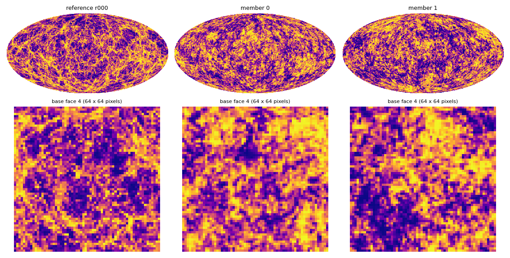
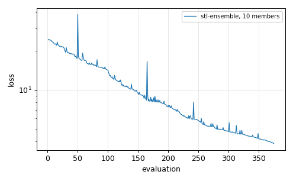

# Ensemble synthesis: 10 members with P. Campeti's method

`stl-ensemble` synthesises an **ensemble** of `B` maps whose statistics have the mean and the
variance of a set of reference maps (a population), rather than one map that matches one target.
It is the Rust port of P. Campeti's method (STL_ensemble v2, variance ratio). The variables are
Gaussian maps `g`, the physical maps are `kappa = f(g) − mean` through a lookup table pooled over
the references, and the loss averages five blocks, each with a mean term and a variance term:

| Block | Statistics |
|---|---|
| `gaussian_sc` | ScatCov (full plan, `L = 4`, kernel 5) of `g` |
| `physical_sc` | ScatCov of `kappa` |
| `power` | 16 log C_ℓ bands of `kappa` |
| `pdf` | pixel PDF (CIC) of `kappa` |
| `mf` | harmonic Minkowski functionals of `kappa` |

This is the method of the nside 1024 production on one A100
([step by step](../../docs/campeti_production_1024.md)). The design and its validation against his
Python code are in [the merge report](../../docs/campeti_merge.md).

## Run

The references are ten full-sky NESTED maps, here the ten Takahashi et al. (2017) convergence
realisations r000–r009 (source redshift zs1) at nside 256. Any nside ≥ the synthesis nside works,
since the calibration block-averages them. `tools/prepare_healpix_target.py` converts RING maps to
NESTED.

```bash
cargo build --release -p stl-cli --features gpu
REFS="$(ls /data/takahashi/r00?_nside256_nested.npy)" bash examples/02_healpix_ensemble/run.sh   # NSIDE=64 NITER=300
```

The commands it runs:

```bash
# 1. calibration: LUT g -> kappa pooled over the references, targets of the five blocks
#    (mean of a bootstrap draw, variance of the references), C_l of the initial Gaussian fields
stl-ensemble calibrate --references r000.npy ... r009.npy --nside 64 --out out/cal.json --gpu
# 2. synthesis: 10 members in one batch on one GPU; the C_l variance term up to l = 3 nside - 1,
#    the production rule (--ps-variance-upper is required at any nside but 128)
stl-ensemble run --calibration out/cal.json --niter 300 --ps-variance-upper 191 --gpu --out out/ens
```

The production options at nside 1024 are the same with `--nside 1024`, `--ps-variance-upper 3071`,
`--niter 2500 --max-eval 50000` and `--checkpoint N` for restarts. On several GPUs,
`mpirun -n G stl-ensemble run ... --gpu --groups G` puts `10 / G` members on each.

## Results





Top: Mollweide views of the first reference (block-averaged to nside 64) and of two members;
bottom: one base face. All panels share one histogram-equalised colour scale, set by the
reference's pixel distribution (healpy's `norm='hist'`), which balances the colours of the skewed
κ field. After this short run the members have the large-scale structure of the references but
not yet their network of thin filaments, and the loss is still falling.

| Step | Time | Notes |
|---|---|---|
| calibrate | 19 s | 10 maps at nside 256, block-averaged to 64 |
| run, 300 iterations (375 evaluations) | 677 s wall, 1.68 s per evaluation | 10 members at once on one T4; setup 17 s |

Loss 24.4 → 3.84 after 375 evaluations. Final blocks (mean term + variance term):

| Block | Loss | Mean | Variance |
|---|---|---|---|
| Gaussian SC | 7.71 | 6.39 | 1.32 |
| Physical SC | 4.74 | 4.36 | 0.38 |
| C_ℓ | 0.46 | 0.04 | 0.43 |
| PDF | 0.65 | 0.24 | 0.41 |
| Minkowski | 5.63 | | |

This short run is not converged: the full runs use 2500 iterations (at nside 128 the loss went from
61.8 to 0.625 in 2869 evaluations, [merge report](../../docs/campeti_merge.md), section 8.5). Time
per evaluation on the T4: ScatCov of `g` 0.50 s and of `kappa` 0.52 s, Minkowski functionals
0.41 s, C_ℓ and PDF 0.23 s. The T4 was shared with a PyTorch training job during the run (peak
5.0 GB on the device, both jobs included). Host peak 0.69 GB.

## Outputs (`out/`)

| File | Content |
|---|---|
| `cal.json` | calibration (LUT, targets, initial C_ℓ) |
| `ens.json` | `loss_history`, `blocks_history`, `blocks_final`, `timers_seconds`, device and host peaks |
| `ens_mMMM_gaussian_nested.npy` | the variable `g` of member `MMM` |
| `ens_mMMM_physical_nested.npy` | `kappa = f(g) − mean` of member `MMM` |

## The other ensemble mode

`stl-synth --ensemble B` matches the **mean** statistics of the members to those of **one** target
map, with optional extra terms that hold their scatter (`--scatter-weight 1` gives an ergodic
ensemble), the power of every level (`--level-power-weight`), the pixel histogram
(`--marginal-weight`), the statistics of `kappa = f(g)` (`--kappa-table`) and Minkowski functionals.
The recipes and measurements are in [USAGE](../../docs/USAGE.md), section 5.4, and in the
[GPU report](../../docs/gpu.md), section 5.1.
