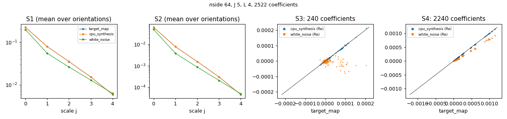

# Statistics of maps with `stl-stats`

`stl-stats` computes the scattering-covariance statistics of HEALPix maps with the plan and the
engine of `stl-synth`. This example computes them for three maps at nside 64: the WebSky κ target
(`fixtures/synthesis/.../target_map.npy`), its synthesis from [example 01](https://github.com/jmdelouis/STL-Dev-MPI/tree/main/examples/01_healpix_synthesis)
and a white-noise map. All three are standardised by the target's mean and standard deviation
(`--norm`), so that their statistics are in the same units.

```bash
bash examples/03_statistics/run.sh          # after example 01; GPU=0 without a device
```

The commands it runs:

```bash
stl-stats --out out/stats.json --norm target_map.npy --L 4 --ranks 4 \
    -- target_map.npy cpu_synthesis_nested.npy white_noise_nested.npy
stl-stats --out out/stats_gpu.json --norm target_map.npy --L 4 --gpu -- ...
python examples/plotting.py stats stats.png out/stats.json
```

## Output

`stats.json` holds the plan, one entry per coefficient (`family`, `j1`, `j2`, `j3`, `l1`, `l2`,
`l3`, `native_dg`), and for each map its `file`, raw `mean` and `std`, the time and the values
(`re`, `im`, in the order of the plan). At nside 64, `J = 5`, `L = 4`: 2522 coefficients (2 + 20
S1 + 20 S2 + 240 S3 + 2240 S4).

```python
import json, numpy as np
r = json.load(open("out/stats.json"))
fam = np.array([c["family"] for c in r["plan"]])
s = {m["file"]: np.array(m["re"]) + 1j * np.array(m["im"]) for m in r["maps"]}
```



S1 and S2 per scale (averaged over the orientations): the synthesis lies on the target, white
noise of the same variance has a different spectrum. S3 and S4 against those of the target: the
synthesis is on the diagonal, while the S3 of white noise scatter around zero (no phase
coupling between scales).

## Timings (garoupe, 12 Xeon Bronze cores, Tesla T4)

| Run | Per map | Total (setup included) |
|---|---|---|
| CPU, 4 thread ranks | 2.3–2.6 s | 7.5 s |
| GPU (T4) | < 0.1 s | 17.8 s (NVRTC compilation and device setup) |

CPU and GPU agree to 4.8e-15 on every coefficient.
