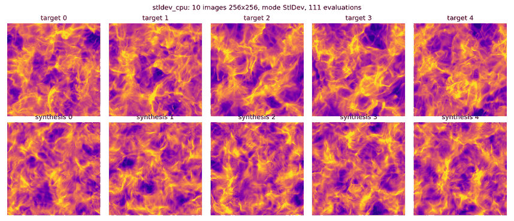
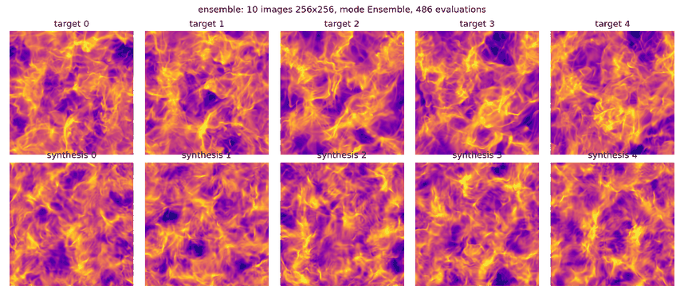
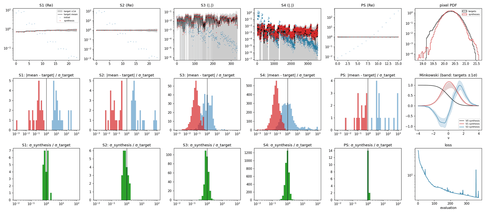

# 2D synthesis: STL-Dev's example, 10 images of 256 × 256

The planar engine runs the same block-wise pyramid on periodic grids (square tiles instead of
NESTED blocks), with STL-Dev's 2D kernels (`STL_2D_Kernel_Torch`, `L = 4`, 5 × 5 wavelets,
stride-2 raised-cosine decimation): statistics and gradients match STL-Dev to 1e-10. This example
reproduces STL-Dev's 2D example, 10 images of 256² synthesised from the first 10 images of
`Turb_6.npy` (STL-Dev repository, `data/test/Turb_6.npy`, 20 images of 256², not shipped here).

```bash
cargo build --release -p stl-cli --features gpu
TURB=/path/to/STL-Dev/data/test/Turb_6.npy bash examples/04_planar_synthesis/run.sh
```

The commands it runs:

```bash
# STL-Dev's own loss (synthesize_from_maps: ScatCov J = 6, L = 4, and the power spectrum)
stl-synth2d --target Turb_6.npy --ntarget 10 --nbatch 10 --mode stldev --niter 100 --out out/stldev_cpu
stl-synth2d --target Turb_6.npy --ntarget 10 --nbatch 10 --mode stldev --niter 100 --gpu --out out/stldev_gpu
# ensemble loss: ScatCov + power spectrum + Minkowski functionals, mean AND variance over the
# batch against those of the targets, after 100 warm-start iterations on the stldev loss
stl-synth2d --target Turb_6.npy --ntarget 10 --nbatch 10 --mode ensemble --warm 100 --niter 300 --gpu --out out/ensemble
python tools/plot_planar.py --run out/ensemble --fig out/fig
```

## Results

STL-Dev's loss, 100 iterations from white noise (first 5 of the 10 images):



Ensemble loss with warm start (first 5 images):





Top row: each family against the targets' mean ±1σ (grey), initial (blue) and final (red)
batch mean; pixel PDF. Middle: distance of the batch mean to the targets' mean in units of the
targets' scatter; Minkowski functionals. Bottom: scatter of the syntheses over that of the
targets; loss. After the ensemble run, the median distance is 0.06σ to 0.24σ for every family
(S1 0.17, S2 0.06, S3 0.08, S4 0.07, power spectrum 0.24) and 99.9 % of the coefficients are
within 1σ; the scatter of the batch is 0.80 to 1.01 times that of the targets.

| Run | Evaluations | s / evaluation | Wall clock | Loss | Peak memory |
|---|---|---|---|---|---|
| stldev, CPU (12 threads) | 111 | 1.06 | 119 s | 3.06e5 → 0.099 | 0.84 GiB |
| stldev, GPU (T4) | 110 | 0.69 | 92 s | 3.06e5 → 0.097 | 0.92 GiB host |
| ensemble, warm start, GPU (T4) | 486 | 0.84 | 425 s | 66.8 → 1.79 | 1.18 GiB host |

These timings were taken on garoupe while other jobs were running: CPU load 5 to 16 on its 12
cores, and a PyTorch training run sharing the T4 (93 % busy). The device peak in the reports
(4.1 to 4.2 GiB) counts the whole device, so it includes that job too. On idle hardware the same
evaluation takes 0.46 s on the 12 cores and 0.18 s on a T4 with 0.3 GB, against 5.0 s / 4.5 GB
(CPU) and 0.64 s / 2.8 GB (T4) for STL-Dev itself ([planar report](../../docs/planar_2d.md),
section 5).

From white noise, the ensemble loss stalls (loss about 145). Starting it with `--warm 100` on
STL-Dev's loss, which is well conditioned, gives the result above.

## Outputs (`out/`)

| File | Content |
|---|---|
| `PREFIX_maps.npy` | `[B, C, H, W]` syntheses in the targets' units |
| `PREFIX_target.npy` | the targets used |
| `PREFIX_features_{target,init,final}.npy` | statistics `[rows, n, 2]` (re, im) |
| `PREFIX_mf_{target,init,final}.npy` | Minkowski functionals (ensemble mode) |
| `PREFIX.json` | report: `loss_history`, `families`, `seconds_per_evaluation`, peaks |
