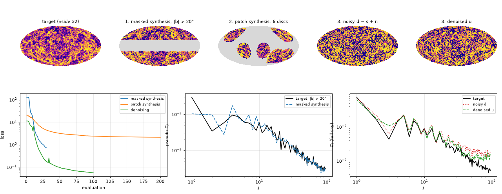

# Differentiable losses in Python

The statistics and pseudo-spectra of STL-Dev-MPI are differentiable functions in Python
(`stl_port.native`, see [the user guide](https://github.com/jmdelouis/STL-Dev-MPI/blob/main/docs/user-guide/differentiable.md)).
This example wraps the three engines as torch operations and optimises three losses with
`torch.optim.LBFGS` on a map at nside 32. The target is the weak-lensing convergence of
Takahashi et al. (2017) used by the other HEALPix examples (realisation r000, source redshift
zs1, `fixtures/takahashi/`), degraded from nside 64 and standardised. It runs on a laptop CPU in about two minutes.

```bash
cargo build --release -p stl-bridge                  # libstl_bridge.so
PY=/path/to/python bash examples/06_differentiable_python/run.sh   # numpy, torch, matplotlib, healpix-geo
```

`run.sh` sets `STL_NATIVE_LIBRARY` to `$STL_BIN/libstl_bridge.so` and runs `run.py`, which writes
`out/maps.npy`, `out/report.json` and the figure `losses.png`.

## The torch wrapper

`stl_torch.py` holds one `torch.autograd.Function` with four entry points:

| Function | Engine | Input | Output |
|---|---|---|---|
| `scattering(engine, x)` | `NativeEngine` (full sky, masks, cross) | `[B, npix]` (`[B, 2, npix]` cross) | complex `[B, (K,) ncoeff]` |
| `patches(engine, x)` | `PatchEngine` after `select` | one full-sky map `[npix]` (`[2, npix]` cross) | complex `[B, ncoeff]`, one row per disc |
| `discs(engine, x)` | `PatchEngine` after `select` | one patch per disc, `[B, n]` (`[B, 2, n]` cross) | complex `[B, ncoeff]` |
| `spectrum(engine, x)` | `SpectrumEngine` | as `engine.forward` | `C_ℓ` |

The forward copies the tensor to numpy and calls the engine with a fresh generation. The backward
calls `engine.vjp` with that generation and the cotangent torch provides (`dL/dRe + i dL/dIm` for
complex outputs). An engine keeps only its last forward, so each term of a loss has its own engine,
or several terms share one batched call.

## The run

**0. Gradient check.** For each wrapper, the torch gradient of a random linear functional is
compared with a central finite difference along a random direction (step 1e-5):

| Wrapper | Relative difference |
|---|---|
| `NativeEngine`, one mask | 3.9e-9 |
| `NativeEngine`, cross | 1.3e-7 |
| `PatchEngine`, 2 discs | 8.9e-11 |
| `SpectrumEngine`, one mask | 2.6e-9 |

The differences are those of the finite differences; the VJPs are exact (the Rust tests bound
them to 1e-10).

**1. Masked synthesis.** Starting from white noise, the loss makes the map match the target's
scattering statistics averaged over `|b| > 20°` (`NativeEngine(masks=...)`, ergodic reduced χ²)
and its pseudo-`C_ℓ` on the same mask (`SpectrumEngine(masks=...)`, cosmic-variance weights). The
band `|b| < 20°` stays unconstrained.

**2. Patch synthesis.** The statistics of six discs of the target (centres drawn among the
nside-2 pixels, `R = 30°`, core 20°) are imposed on the same discs of a white-noise map
(`PatchEngine`). The gradient flows to the full sky through torch's indexing (`patches`), so the
map changes only inside the discs.

**3. Denoising with cross statistics** (Delouis et al. 2022, A&A 668, A122). With `d = s + n`
(noise of the pixel standard deviation of `s`) and three noise draws `n_b`, the map `u`, started
from `d`, minimises

    chi2( <S(u + n_b, u + n_b)>_b , S(d, d) ) + chi2( <S(u + n_b, u)>_b , S(d, u) )

The seven pairs form one batch of a cross engine. On the CPU this run uses `PatchEngine` with
seven discs of 180°: they give the full-sky statistics and run on parallel threads (0.63 s per
evaluation, against 5.3 s for `NativeEngine(cross=True, batch=7)`, which runs on one thread).

| Loss | Evaluations | Time (WSL, 20 threads) | Loss, first → last |
|---|---|---|---|
| 1. masked synthesis | 30 | 57 s (1.9 s each) | 127 → 0.73 |
| 2. patch synthesis | 200 | 3.5 s (0.02 s each) | 20.4 → 2.1 |
| 3. denoising | 100 | 64 s (0.64 s each) | 11.2 → 0.056 |



Top row, left to right: the target, the masked synthesis (the unconstrained band in grey), the
patch synthesis (grey outside the discs), the noisy map and the denoised map, all on the
target's histogram-equalised colour scale. Bottom row: the losses, the masked pseudo-`C_ℓ` of the
target and of the synthesis, and the full-sky `C_ℓ` of `s`, `d` and `u`.

The denoiser restores statistics more than pixels. The mean of `|log C_ℓ(·) / C_ℓ(s)|` over
`ℓ ≥ 2` drops from 0.63 for `d` to 0.41 for `u`, while the pixel error drops only from 1.00
(rms of `d − s`) to 0.94 (`u − s`). `u` is a map with the statistics of the signal more than a
pixel-wise estimate of it. Longer runs, more noise draws and the third loss of the paper (with a
template) bring the spectrum closer. The whole run takes 126 s on the laptop.
